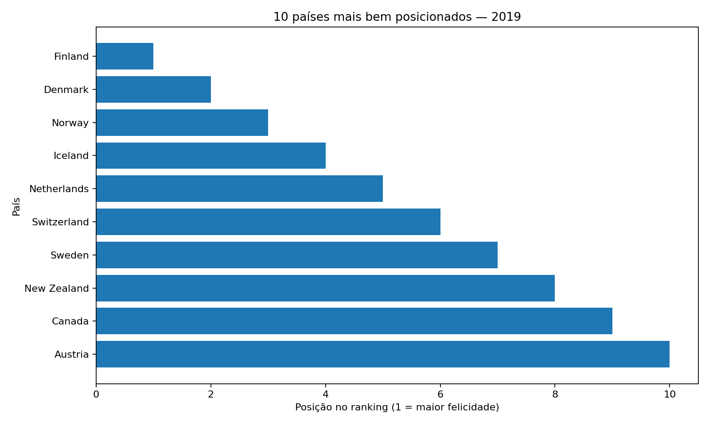
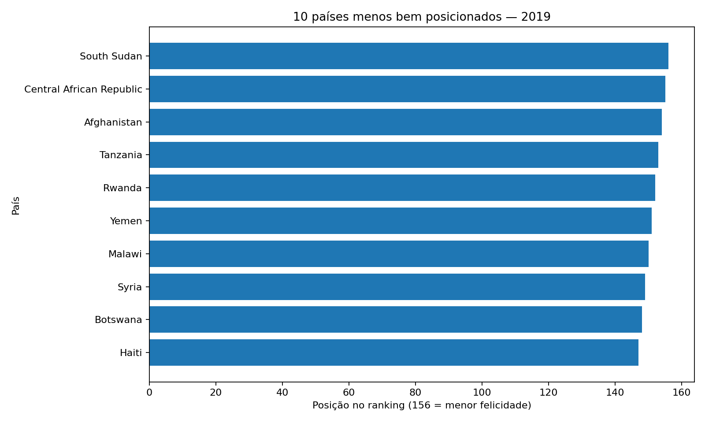
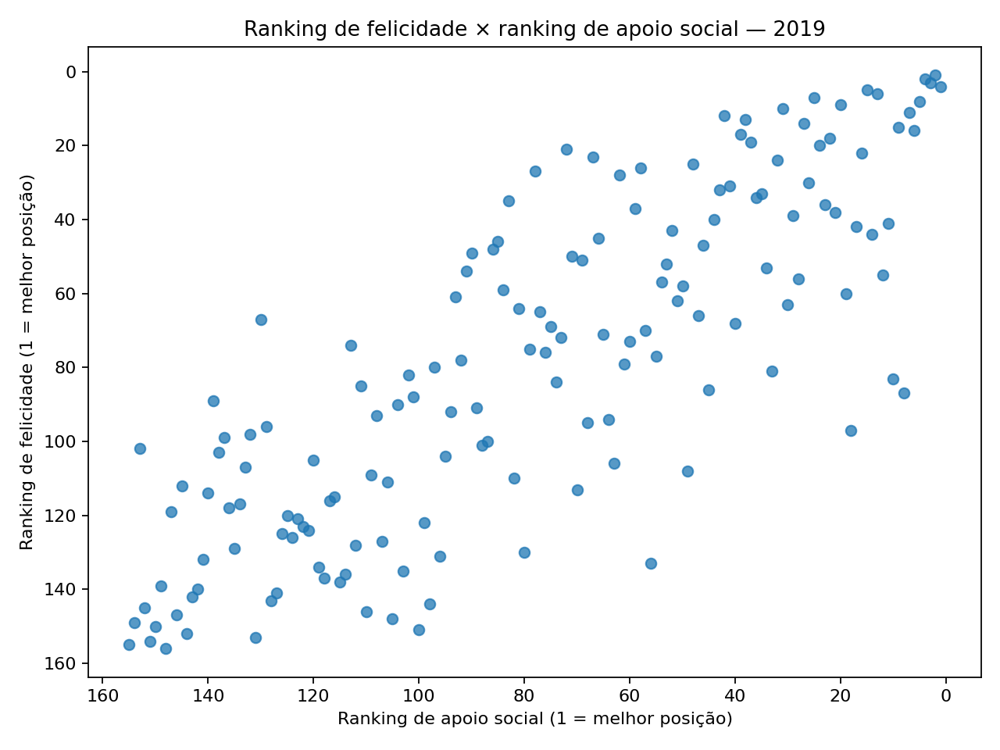
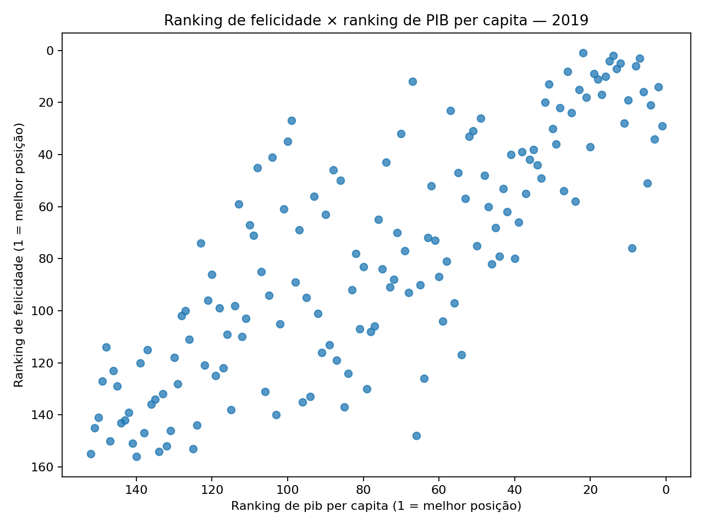
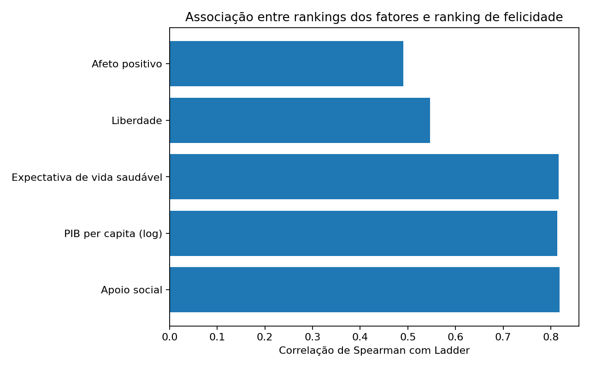

# Felicidade Mundial 2019 — análise exploratória

**Candidato:** Pedro Miguel Lopes Martins

## Pergunta orientadora
Quais fatores aparecem associados às maiores pontuações de felicidade e quais cuidados devem ser tomados ao interpretar essa relação?

## Objetivo
Explorar os dados do World Happiness Report 2019, verificar sua qualidade, resumir o ranking de felicidade dos países e investigar associações entre esse ranking e fatores socioeconômicos e de bem-estar.

## Fonte dos dados
- Dataset no Kaggle: [World Happiness Report — 2019.csv](https://www.kaggle.com/promptcloud/datasets)
- O CSV corresponde ao conjunto **World Happiness Report 2019** publicado por PromptCloud no Kaggle; a página do publicador lista esse dataset. O arquivo analisado é `data/world-happiness-report-2019.csv`, fornecido para este projeto.
- Página descritiva do mesmo esquema de dados: [PromptCloud — World Happiness Report Dataset 2019](https://www.promptcloud.com/world-happiness-report-dataset-2019/).
- Consulte a página do Kaggle e respeite os termos/licença indicados pelo responsável pelo dataset antes de redistribuir os dados.

## Atenção: o que significa `Ladder`?
O CSV recebido **não contém uma coluna de pontuação numérica de felicidade (por exemplo, 7,7 em uma escala de 0 a 10)**. A coluna `Ladder` representa a **posição no ranking**: 1 é a melhor posição e 156 a pior. Portanto, a média e a mediana calculadas neste projeto são estatísticas das posições no ranking, não médias/medianas de uma pontuação de felicidade. Para analisar a pontuação original em escala de 0 a 10, seria necessário obter uma versão do dataset que contenha a coluna `Score`.

Além disso, as colunas de fatores deste arquivo também aparecem como posições/rankings (1 indica posição mais alta no fator), e não como valores brutos de PIB, expectativa de vida ou apoio social. Por isso, a análise de associação usa correlação de Spearman entre posições.

## Estrutura do repositório
```text
projeto_felicidade_mundial_2019/
├── README.md
├── analise.py
├── requirements.txt
├── .gitignore
├── data/
│   ├── README.md
│   └── world-happiness-report-2019.csv
└── images/
    ├── top10_paises.png
    ├── bottom10_paises.png
    ├── felicidade_apoio_social.png
    ├── felicidade_pib.png
    └── correlacoes_spearman.png
```

## Ferramentas e tecnologias
- Python 3.10 ou superior
- pandas: leitura, limpeza e análise tabular
- NumPy: operações numéricas
- Matplotlib: gráficos
- Git/GitHub: versionamento e publicação do projeto

## Etapas realizadas e qualidade dos dados
- **Países/registros:** 156.
- **Variáveis/colunas:** 11 (1 identificador de país e 10 variáveis numéricas).
- **Valores ausentes:** 23 células ausentes no total.
- **Duplicidades:** 0 linhas duplicadas; 0 nomes de países repetidos.
- **Ranking `Ladder`:** valores inteiros, sem ausências e sem repetição; intervalo observado de 1 a 156.
- Não foi identificada inconsistência estrutural evidente no ranking principal. Valores ausentes nas demais colunas foram mantidos como ausentes e excluídos automaticamente dos cálculos que dependem delas; não foram preenchidos artificialmente.

### Valores ausentes por coluna
|                 |   Valores ausentes |
|:----------------|-------------------:|
| Positive affect |                  1 |
| Negative affect |                  1 |
| Social support  |                  1 |
| Freedom         |                  1 |
| Corruption      |                  8 |
| Generosity      |                  1 |
| Log of GDP      |                  4 |
| per capita      |                    |
| Healthy life    |                  6 |
| expectancy      |                    |

## Resultados

### Média e mediana do ranking
- **Média de `Ladder`:** 78.50.
- **Mediana de `Ladder`:** 78.50.

A média é a soma das posições dividida pelo número de países. A mediana é o valor central após ordenar as posições. Como o ranking vai de 1 a 156 e cada posição aparece uma vez, ambas ficam em 78,5. Isso descreve o centro matemático das posições; **não significa que a felicidade média seja 78,5 pontos**.

### Dez países mais bem posicionados
| Country (region)   |   Ladder |
|:-------------------|---------:|
| Finland            |        1 |
| Denmark            |        2 |
| Norway             |        3 |
| Iceland            |        4 |
| Netherlands        |        5 |
| Switzerland        |        6 |
| Sweden             |        7 |
| New Zealand        |        8 |
| Canada             |        9 |
| Austria            |       10 |

### Dez países menos bem posicionados
| Country (region)         |   Ladder |
|:-------------------------|---------:|
| South Sudan              |      156 |
| Central African Republic |      155 |
| Afghanistan              |      154 |
| Tanzania                 |      153 |
| Rwanda                   |      152 |
| Yemen                    |      151 |
| Malawi                   |      150 |
| Syria                    |      149 |
| Botswana                 |      148 |
| Haiti                    |      147 |

### Associação com outros fatores
Foi utilizada a **correlação de Spearman** entre `Ladder` e os rankings de cada fator. Como números menores indicam posições melhores em ambos os rankings, uma correlação positiva significa que países em posições piores no ranking de felicidade tendem também a ocupar posições piores naquele fator. A magnitude indica a força da associação monotônica, não causalidade.

| Fator | Correlação de Spearman com Ladder |
|---|---:|
| Apoio social | 0.818 |
| PIB per capita (log) | 0.813 |
| Expectativa de vida saudável | 0.817 |
| Liberdade | 0.546 |
| Afeto positivo | 0.491 |

### Gráficos
1. **Top 10 países:** compara as posições dos dez países mais bem classificados; quanto menor o número, melhor a posição.

   

2. **Bottom 10 países:** mostra os dez países nas últimas posições do ranking.

   

3. **Felicidade e apoio social:** cada ponto representa um país; os eixos são posições nos rankings. A tendência ajuda a visualizar a associação entre as duas classificações.

   

4. **Felicidade e PIB per capita:** compara as posições nos rankings de felicidade e PIB per capita.

   

5. **Correlações:** resume as correlações de Spearman dos rankings de fatores com `Ladder`.

   

## Conclusões objetivas
1. O arquivo reúne 156 países e 11 colunas, das quais 10 são numéricas.
2. Foram encontrados 23 valores ausentes; a maior parte está na coluna de percepção de corrupção (8 ausências).
3. Não há linhas duplicadas nem países repetidos no arquivo.
4. A média e a mediana de `Ladder` são ambas 78,5, mas representam posições no ranking, não uma pontuação em escala de felicidade.
5. Apoio social apresenta uma associação monotônica forte com o ranking de felicidade (Spearman = 0.818).
6. PIB per capita (log) também apresenta associação forte (Spearman = 0.813), assim como expectativa de vida saudável (Spearman = 0.817).
7. Liberdade apresenta associação moderada (Spearman = 0.546); afeto positivo apresenta associação moderada (Spearman = 0.491).
8. Essas associações descrevem padrões entre países em 2019 e não demonstram que um fator cause diretamente maior felicidade.

## Limitações e cuidados de interpretação
- **Variável-alvo:** o arquivo disponibilizado tem `Ladder` (posição), não a pontuação original de felicidade em escala 0–10. Isso limita a interpretação da média e da mediana solicitadas.
- **Rankings, não medidas brutas:** as colunas de fatores também estão expressas como posições; a correlação avalia concordância entre ordenações, não o tamanho real das diferenças entre países.
- **Dados ausentes:** algumas variáveis não têm observação para todos os países, reduzindo o número de pares usados em cada correlação.
- **Diferenças culturais e linguísticas:** a forma como as pessoas entendem e respondem às perguntas pode variar entre culturas.
- **Métodos de pesquisa:** resultados dependem de amostragem, questionários, estimativas e fontes usadas pelo relatório.
- **Retrato temporal:** trata-se de um recorte de 2019, não de uma descrição da situação atual nem de tendências ao longo do tempo.
- **Associação não é causalidade:** fatores sociais e econômicos podem estar relacionados entre si e com outras condições não observadas. Uma correlação não comprova causa e efeito.

## Como executar
1. Instale Python 3.10+.
2. Crie e ative um ambiente virtual (opcional, mas recomendado).
3. Instale as dependências:
   ```bash
   pip install -r requirements.txt
   ```
4. Execute:
   ```bash
   python analise.py
   ```
5. O script lê o CSV em `data/`, imprime os indicadores no terminal e recria os gráficos em `images/`.

## Observação para publicação no GitHub
Adicione os arquivos deste diretório a um repositório novo. Antes de publicar o CSV, confira as condições de uso e atribuição na página do dataset no Kaggle. Se preferir não redistribuir os dados, remova o CSV e siga as instruções em `data/README.md`.
